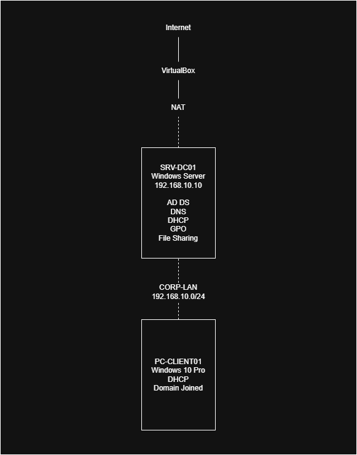

# Small Office IT Infrastructure & Support Lab

A hands-on virtual lab for practicing Windows system
administration, network administration, information
security, and IT troubleshooting.

## Project Overview

This project simulates a small office IT environment
using Windows Server 2022 and Windows 10 Pro virtual
machines.

## Architecture

## Environment

| Component  | Configuration       |
| ---------- | ------------------- |
| Hypervisor | VirtualBox          |
| Server     | Windows Server 2022 |
| Client     | Windows 10 Pro      |
| Domain     | corp.local          |
| Network    | 192.168.10.0/24     |
| Server IP  | 192.168.10.10       |

## Implemented Services

- Active Directory Domain Services
- DNS
- DHCP
- Group Policy
- File Sharing
- User and Group Management

## Security

- Password Policy
- Account Lockout Policy
- Windows Firewall
- Windows Defender
- Audit Policy
- NTFS Permissions

## Troubleshooting

Practiced troubleshooting scenarios involving:

- DHCP
- DNS
- Domain Authentication
- File Permissions
- Group Policy

## Documentation

- [Network Design](docs/network-design.md)
- [Project Summary](docs/project-summary.md)
- [Troubleshooting](docs/troubleshooting.md)
